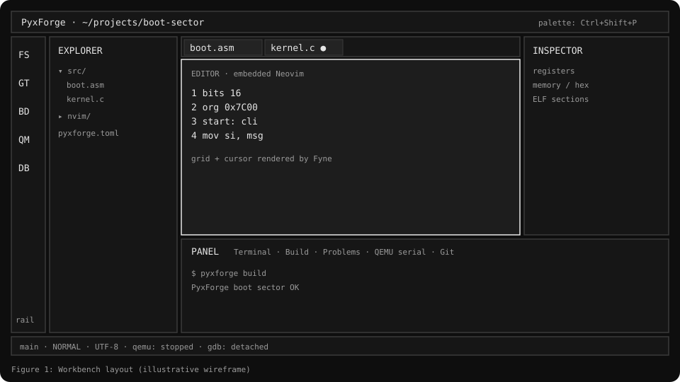
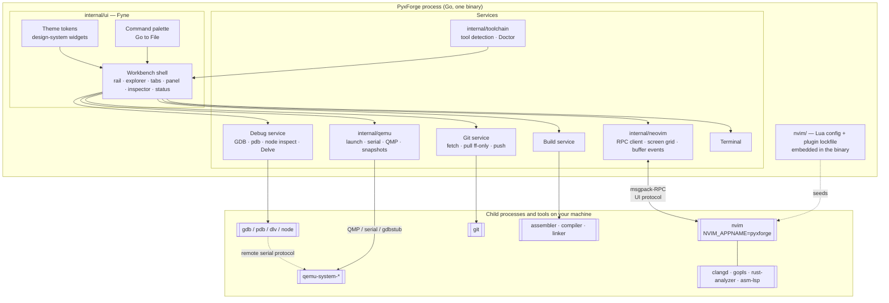
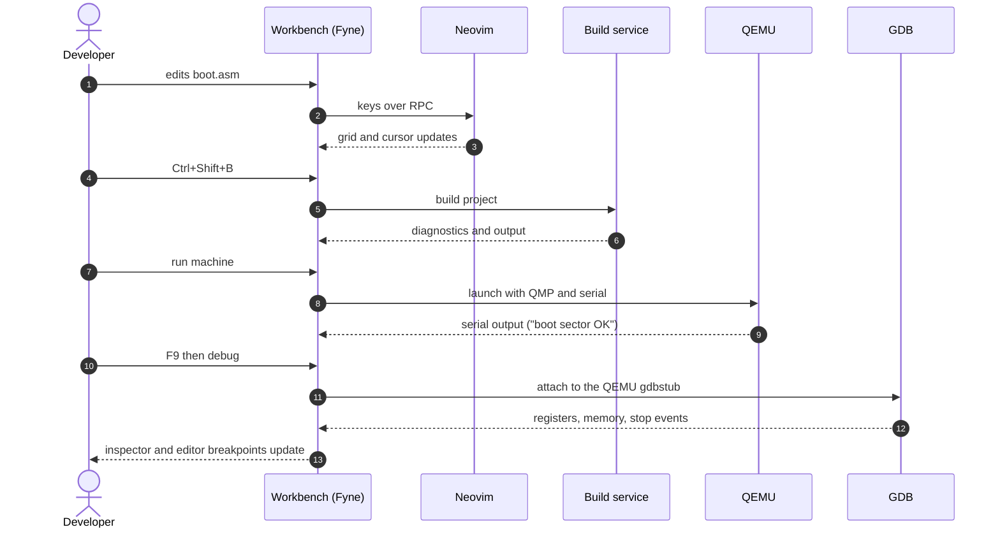
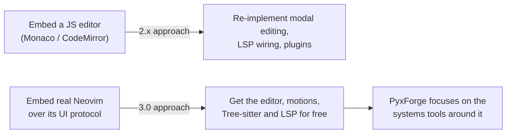
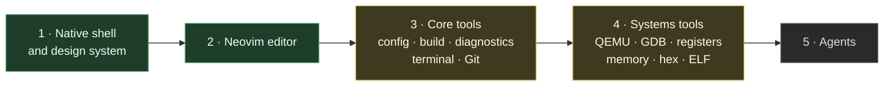

<div align="center">

# PyxForge

**A native, keyboard-first workbench for bootloader, kernel and bare-metal development.**
Editor, build, QEMU, GDB and binary inspection in one offline window.




</div>

---

## Contents

1. [What is PyxForge](#what-is-pyxforge)
2. [Highlights](#highlights)
3. [Status](#status)
4. [Architecture](#architecture)
5. [Tech stack and versions](#tech-stack-and-versions)
6. [Tech stack research notes](#tech-stack-research-notes)
7. [Install](#install)
8. [Build from source](#build-from-source)
9. [Usage](#usage)
10. [Repository layout](#repository-layout)
11. [Design principles](#design-principles)
12. [Roadmap](#roadmap)
13. [Known limitations](#known-limitations)
14. [Contributing](#contributing)
15. [Verifying releases](#verifying-releases)

---

## What is PyxForge

Writing an operating system means juggling an editor, an assembler or compiler, a linker, QEMU, GDB and a hex or ELF viewer, usually in six windows with six configurations. PyxForge brings them into **one keyboard-first workspace that works offline**.

PyxForge 3.0 is a rewrite in **Go and Fyne** that embeds **real Neovim** as its editor. It replaces the 2.x Tauri desktop app and VS Code extension, which stay in `legacy/` until 3.0 reaches feature parity.

> The editor is not an imitation. Files open in an actual `nvim` process driven over its RPC and UI protocol, so motions, registers, macros, Tree-sitter and LSP behave exactly as they do in a terminal.

---

## Highlights

| | |
|---|---|
| **Real Neovim, isolated** | Runs PyxForge's own Lua configuration with `NVIM_APPNAME=pyxforge`. It never reads or changes your personal Neovim setup. |
| **Native shell** | Rail, file explorer, editor tabs, bottom panel, inspector, status bar, command palette and Go to File. Each workspace reopens as you left it. |
| **Run and debug the current file** | `Ctrl+Shift+F9` runs the file; `F9` sets an editor breakpoint. Debugging uses GDB, pdb, `node inspect` or Delve depending on the language. |
| **Systems workflow** | Build, boot in QEMU, attach GDB, inspect registers, memory and ELF in one loop. |
| **Git built in** | Fetch, fast-forward pull and push from the Git tab. |
| **Toolchain doctor** | `pyxforge doctor` detects Neovim, assemblers, compilers, linkers, QEMU, GDB and Git, and can print install commands. |
| **Offline, no telemetry** | Nothing phones home. |
| **Reproducible builds** | CI builds each program twice and checks the results are byte-identical. |

---

## Status

PyxForge is **pre-release**. Tool-by-tool state, as of the `3.0.0-dev.9237c75` development build:

| Area | State |
|---|---|
| Workbench shell and design system | Working |
| Embedded Neovim editor (tabs, unsaved markers, `Ctrl+S`, close prompts, system clipboard) | Working (Neovim 0.9+; clipboard needs 0.10+) |
| Tree-sitter and language servers (clangd, gopls, rust-analyzer, asm-lsp) | Working through the bundled Neovim configuration |
| Run Current File, Debug Current File | Working in the dev build |
| Build service, diagnostics, terminal | Working |
| Git: fetch, fast-forward pull, push | Working in the dev build |
| Set Up Machine (QEMU profile for projects without a `[qemu]` table) | Working in the dev build |
| QEMU launch, serial, QMP, machine snapshots | In progress |
| GDB session, registers, memory, hex and ELF inspector | In progress |
| Autonomous agents, Git worktrees | Planned |

Two builds are published on the [Releases page](https://github.com/obstinix/PyxForge/releases): **3.0.0-rc.2** (stable-leaning release candidate, recommended) and **3.0.0-dev.9237c75** (development build, 54 commits ahead of rc.2).

---

## Architecture

### System overview

PyxForge is a single Go binary. The UI never talks to tools directly: it calls services, and services own the child processes.



### The edit → build → boot → debug loop



### Why a Go binary that drives Neovim



### 2.x to 3.0 at a glance

| | 2.x (`legacy/`) | 3.0 |
|---|---|---|
| Language | Rust core + TypeScript | Go |
| Desktop shell | Tauri | Fyne |
| Editor | Web editor / VS Code | Embedded real Neovim |
| Plugins | JavaScript plugin loader | Dropped; Neovim and Lua handle extension |
| Priority platforms | Desktop and VS Code | Windows and Linux first |
| Telemetry | none | none |

---

## Tech stack and versions

Versions below are the ones documented by the repository and its releases. Anything marked **see `go.mod`** is pinned by the Go module file and is deliberately not duplicated here so it cannot drift.

| Layer | Technology | Version | Role in PyxForge |
|---|---|---|---|
| Language | **Go** | 1.27.1 or newer | Whole application, CLI and services |
| GUI toolkit | **Fyne v2** | see `go.mod` | Native windowing and widgets, OpenGL rendering |
| Native bridge | **cgo** + C compiler | any working C toolchain | Required by Fyne's OpenGL drivers |
| Editor engine | **Neovim** | 0.9+ required, 0.10+ for system clipboard; **0.12.6 bundled** with the installer and portable zip | Text editing, buffers, Tree-sitter, LSP client |
| Editor config | **Lua** (Neovim's embedded runtime) | follows Neovim | PyxForge's `nvim/` configuration |
| Neovim client | **go-client** (msgpack-RPC) | see `go.mod` | Go side of the Neovim RPC link |
| Syntax | **Tree-sitter** | parsers bundled with Neovim: C, Lua, Markdown | Highlighting and structural queries |
| Language servers | **clangd, gopls, rust-analyzer, asm-lsp** | user-installed | Diagnostics, completion, navigation |
| Emulator | **QEMU** | user-installed | Boots the OS image; serial, QMP, snapshots |
| Debugger | **GDB** (plus pdb, `node inspect`, Delve) | user-installed | Source-level debugging |
| Version control | **Git** | user-installed | Repository status, fetch, pull, push |
| System bindings | **golang.org/x/sys** | see `go.mod` | Windows and Unix process handling |
| CI/CD | **GitHub Actions** | current runners | Build, test (Windows and Linux), release |
| Integrity | **SHA-256** | n/a | Release checksums (`SHA256SUMS.txt`) |

---

## Tech stack research notes

A short, practical profile of each technology: what it is, why it fits PyxForge, and what it costs.

### Go

Go is a statically typed, compiled language with a built-in concurrency model (goroutines and channels) and a single-binary deployment story. For PyxForge this matters in three ways. First, the app supervises many long-lived child processes (Neovim, QEMU, GDB, builds), and goroutines make it natural to read each process's output without blocking the UI. Second, cross-platform process and file APIs in the standard library keep Windows and Linux behavior close. Third, one statically linked executable makes the installer and the portable zip simple. The trade-off is that the UI toolkit needs cgo, which complicates cross-compilation compared with pure Go.

### Fyne

Fyne is a cross-platform GUI toolkit for Go, inspired by Material Design, that draws its own widgets with OpenGL instead of wrapping native controls. That gives PyxForge identical rendering on Windows and Linux and lets it ship its own **theme tokens and design-system widgets** (the project uses five token-driven themes with independent accent colors, plus a System mode). Rendering through OpenGL is also what requires cgo and a C compiler at build time. The known cost is accessibility: Fyne does not currently expose widgets to screen readers, which is why PyxForge pairs keyboard navigation and a CLI path with the GUI and tracks the gap in its issue tracker.

### Neovim

Neovim is a modern fork of Vim built around an **API-first design**: every editing operation is reachable over msgpack-RPC, and an external **UI protocol** lets a separate program render the editor. PyxForge acts as that external UI. It renders Neovim's screen grid and forwards keys, so behavior is authentic rather than emulated. Neovim also brings a built-in LSP client, Tree-sitter integration and a Lua runtime. PyxForge pins a bundled Neovim (**0.12.6** in the dev build) so behavior is reproducible, requires 0.9 or newer when you bring your own, and isolates its state with `NVIM_APPNAME=pyxforge` so your personal configuration is untouched.

### Lua

Lua is a small, fast embeddable scripting language and Neovim's first-class extension language. PyxForge's editor behavior (keymaps, options, plugin set and a plugin lockfile) lives in the embedded `nvim/` directory and ships inside the binary. Using Lua rather than a bespoke plugin API means contributors can reuse the whole Neovim ecosystem, and it is why the 2.x JavaScript plugin loader could be dropped.

### Tree-sitter

Tree-sitter is an incremental parsing library that builds a concrete syntax tree and updates it cheaply as you type. Neovim uses it for accurate highlighting and structural text objects. The bundled parsers cover C, Lua and Markdown, which are the languages most used in boot and kernel work and in the configuration itself. Other languages fall back to what Neovim installs or to LSP semantic information.

### Language Server Protocol (clangd, gopls, rust-analyzer, asm-lsp)

LSP is a JSON-RPC protocol that lets one editor talk to many language-specific servers for diagnostics, completion and go-to-definition. PyxForge's Neovim configuration wires up the servers most relevant to systems work: **clangd** for C and C++, **gopls** for Go, **rust-analyzer** for Rust and **asm-lsp** for assembly. The servers are not bundled; `pyxforge doctor` reports which are present.

### QEMU and QMP

QEMU is a full-system emulator that can boot a raw boot sector, a kernel or a disk image for x86, ARM, RISC-V and other targets without real hardware. PyxForge controls it through three channels: the **serial port** (so `PyxForge boot sector OK` shows up in the Problems and QEMU panels), **QMP**, QEMU's JSON control protocol for status, pause, resume and snapshots, and the **gdbstub** for debugging. Machine definitions live in a project `[qemu]` table, and *Set Up Machine…* creates one for projects that lack it.

### GDB (and pdb, node inspect, Delve)

GDB debugs native code and speaks the **remote serial protocol**, which is how it attaches to a QEMU guest from the very first instruction, before any operating system exists. For hosted languages PyxForge's *Debug Current File* uses each language's own debugger: **pdb** for Python, **`node inspect`** for JavaScript and TypeScript, and **Delve** for Go. Editor breakpoints are set with `F9`.

### Git

PyxForge shells out to the system `git`, so it behaves exactly like your command line, including credentials and hooks. The Git tab offers fetch, **fast-forward-only pull** and push. The conservative pull is intentional: it avoids surprise merges inside a tool whose users are often mid-experiment. Worktrees are planned, not implemented.

### ELF and binary inspection

ELF is the executable and object format used by Linux and by most freestanding kernel toolchains. The planned inspector reads sections, symbols and segments, and shows registers, memory and hex alongside the debugger so that a link-script or layout mistake is visible without leaving the window.

### GitHub Actions, SHA-256 and reproducible builds

Releases are produced by a Windows workflow that builds both executables twice and requires byte-identical output, then checks the bundled Neovim, version resources and subsystems. `go test ./...` runs on Windows and Linux; macOS is only compile-checked. Every release publishes SHA-256 checksums so downloads can be verified.

---

## Install

Download from the [Releases page](https://github.com/obstinix/PyxForge/releases).

| File | What it is |
|---|---|
| `PyxForge-Setup-<version>.exe` | Per-user installer, no admin rights, includes Neovim. **Recommended** |
| `PyxForge-Portable-<version>.zip` | Portable folder with Neovim and the boot-sector example. Read `PORTABLE.txt` inside |
| `PyxForge-<version>.exe` | The windowed desktop app only (uses `nvim` from your `PATH`) |
| `pyxforge-<version>.com` | The same program built as a console app for the command line |

> The installer and executables are **not code-signed** yet, so Windows SmartScreen may warn on first launch. Upgrades preserve your settings and projects, but back up important work before trying pre-release builds.

External tools are separate installs: Git, QEMU, GDB, compilers, assemblers and language servers. Run `pyxforge doctor` to see what is missing.

---

## Build from source

Requirements: **Go 1.27.1 or newer** and a **C compiler** for cgo (Fyne draws with OpenGL).

```bash
git clone https://github.com/obstinix/PyxForge.git
cd PyxForge
go build -o pyxforge ./cmd/pyxforge

./pyxforge doctor              # which tools were found
./pyxforge doctor --commands   # print install commands for what is missing
./pyxforge path/to/project     # open the desktop app on a project
```

Run the tests:

```bash
go test ./...
```

---

## Usage

### Command line

| Command | Purpose |
|---|---|
| `pyxforge [path]` | Open the desktop app on a project folder |
| `pyxforge doctor` | Detect tools; configure executable paths |
| `pyxforge doctor --commands` | Print install commands for missing tools |
| `pyxforge setup editor` | Prepare PyxForge's isolated Neovim |

### Keyboard

| Keys | Action |
|---|---|
| `Ctrl+S` | Save the current buffer |
| `Ctrl+Shift+B` | Build |
| `Ctrl+Shift+F9` | Run Current File (Python, JS, TS, Go, Rust, C, C++, Java, shell, PowerShell, batch, Lua, Ruby, Perl, PHP, HTML) |
| `F9` | Toggle an editor breakpoint |
| Command palette | Every action, searchable; Go to File |

### A first session

1. Open the bundled boot-sector example from the portable zip.
2. Press `Ctrl+Shift+B` to assemble it.
3. Run the machine; the QEMU serial output should print `PyxForge boot sector OK`.
4. Set a breakpoint with `F9` and start a debug session.

---

## Repository layout

```text
PyxForge/
├── cmd/pyxforge/        Entry point: desktop app and command line
├── internal/
│   ├── ui/              Workbench shell, editor view, explorer, palette,
│   │                    design-system widgets, themes, icons
│   ├── neovim/          Embedded Neovim: process, RPC, screen grid,
│   │                    buffer and terminal events
│   ├── qemu/            QEMU launch, serial output, QMP, machine snapshots
│   └── toolchain/       Detection of Neovim, assemblers, compilers,
│                        linkers, QEMU, GDB and Git
├── nvim/                PyxForge's Neovim configuration (Lua) and plugin
│                        lockfile, embedded in the binary
├── docs/                Design notes, audit register, ADRs
├── assets/              README figures
└── legacy/              2.x Tauri app and VS Code extension (until parity)
```

---

## Design principles

- **Keyboard first.** Every action has a keyboard path and a palette entry.
- **Offline and private.** No telemetry, no network requirement for core features.
- **Real tools, not imitations.** Real Neovim, real QEMU, real GDB; PyxForge orchestrates, it does not re-implement.
- **Isolation.** PyxForge's Neovim keeps its settings, plugins and history in its own folders, per workspace.
- **Honest status.** Panels for unbuilt tools say what arrives and when.
- **Tokens, not one-offs.** Themes are token-driven, with independent accent colors and a System mode.

---

## Roadmap



Near-term items: QEMU and GDB integration to parity with 2.x, workspace switching without blocking the UI thread, macOS runtime testing, code signing, dependency update automation, and a documented accessibility statement with CLI equivalents for every palette command.

---

## Known limitations

- Installer and programs are **not code-signed**; SmartScreen may warn.
- Pull is **fast-forward only**. Agents and Git worktrees are not implemented.
- **macOS is only compile-checked**; there is no macOS test run in CI yet.
- Fyne does not expose the UI to screen readers. Keyboard navigation is available, and a CLI-first workflow is the recommended alternative.
- Development builds are not release candidates. For stable use, stay on the latest `rc`.

Open issues: <https://github.com/obstinix/PyxForge/issues>

---

## Contributing

1. Open an issue before large changes so the direction can be agreed.
2. Keep changes small and focused: one logical change per commit, conventional commit messages (`feat:`, `fix:`, `docs:`, `chore:`).
3. Run `go vet ./...` and `go test ./...` before pushing.
4. Pull requests that touch process lifecycle (builds, QEMU, GDB, terminals) should include a real-process test, not a mock.

---

## Verifying releases

```bash
# Windows PowerShell
Get-FileHash .\PyxForge-Setup-<version>.exe -Algorithm SHA256

# Linux / macOS
sha256sum PyxForge-Portable-<version>.zip
```

Compare the output with `SHA256SUMS.txt` on the release page.

---

<div align="center">

Built by [@obstinix](https://github.com/obstinix) · No telemetry · Works offline

</div>
