<p align="center">
  
</p>

<p align="center">
  <b>A native development environment for systems work.</b><br>
  One Go program with its own editor, terminal, build runner, QEMU and GDB front end, and Git client. It works offline.
</p>

<p align="center">
  <a href="#development-status"></a>
  <a href="https://github.com/obstinix/PyxForge/actions/workflows/ci.yml"></a>
  <a href="https://github.com/obstinix/PyxForge/releases"></a>
  <a href="LICENSE"></a>
  
  
  
</p>

<p align="center">
  
  
  <a href="https://github.com/obstinix/PyxForge/issues"></a>
  <a href="https://github.com/obstinix/PyxForge/pulls"></a>
  <a href="https://github.com/obstinix/PyxForge/graphs/contributors"></a>
  
</p>

<p align="center">
  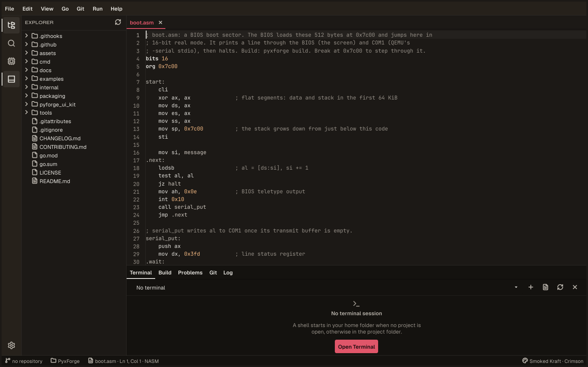
</p>

---

## Contents

1. [Overview](#overview)
2. [Development status](#development-status)
3. [Why PyxForge?](#why-pyxforge)
4. [Features](#features)
5. [Architecture](#architecture)
6. [Engineering principles and architectural foundations](#engineering-principles-and-architectural-foundations)
7. [Technology stack](#technology-stack)
8. [Themes and appearance](#themes-and-appearance)
9. [Part of the PyxisOS ecosystem](#part-of-the-pyxisos-ecosystem)
10. [Screenshots](#screenshots)
11. [Installation](#installation)
12. [Quick start](#quick-start)
13. [Project structure](#project-structure)
14. [Roadmap](#roadmap)
15. [Contributing](#contributing)
16. [Contributors](#contributors)
17. [License and code of conduct](#license-and-code-of-conduct)
18. [Acknowledgements](#acknowledgements)
19. [References](#references)

---

## Overview

Operating-system and low-level work usually means switching between an editor, an assembler or
compiler, a linker, QEMU, GDB and a hex or ELF viewer, each in its own window with its own
configuration. PyxForge puts that loop in one window:

**edit → build → boot in QEMU → debug with GDB → inspect registers, memory and the binary**

PyxForge 3.0 is a single Go executable that is both the desktop app (Fyne) and a command-line
tool (`pyxforge build`, `run`, `inspect`, `doctor`…). The editor and the terminal are its own
code, not embedded programs. Compilers, QEMU, GDB, Git and language servers are external tools
that PyxForge finds, runs and supervises.

## Development status

> [!IMPORTANT]
> **PyxForge is in active development.** Interfaces and internal architecture still change, and
> packaging is still being hardened. Treat every published build as a development build until a
> stable release is declared. Testing, bug reports and architectural feedback are welcome.

- **Verified platforms:** Windows 11 x64 and Ubuntu 24.04 x64, tested in CI on every push.
  macOS is compile-checked only and is **unsupported** until it has been run.
- **Published builds lag behind `main`:** `3.0.0-rc.2` and `3.0.0-dev.9237c75` (October 2026)
  predate the native editor and terminal and still embed Neovim. To try the current
  architecture, [build from source](#installation).
- **Evidence:** every claim in [`docs/FEATURES.md`](docs/FEATURES.md) names the test that proves
  it on each platform. [`docs/PROJECT_STATE.md`](docs/PROJECT_STATE.md) is the running record.

Status labels used below: **Available** (tested on Windows and Linux), **Experimental** (built
and partly verified), **In development**, **Planned**, **Unsupported**.

## Why PyxForge?

- **One loop for low-level work.** Build profiles, QEMU, a GDB/MI debugger, an inspector
  (registers, flags, memory, disassembly, hex, boot-sector map, ELF) and the editor share one
  project file, `pyxforge.toml`.
- **Native, not a browser.** The app is Go and Fyne, with no HTML, JavaScript or WebView.
  `tools/forbidcheck` enforces that in CI.
- **Offline and private.** No telemetry. Nothing uses the network unless you ask: update checks
  and toolchain downloads are explicit.
- **Real tools, supervised.** Every external program is started with an argument list (never a
  shell string), and its process tree ends with PyxForge, even after a forced exit.

### From 2.x to 3.0

PyxForge 2.x was a Rust core with a Tauri desktop shell and a VS Code extension. 3.0 replaced it
with one Go program (2.x is in git history up to `fd193a2`). Early 3.0 builds embedded
**Neovim** as the editor and terminal. That was reversed by decisions
[D16 and D17](docs/ARCHITECTURE_DECISIONS.md), for three reasons:

- Neovim was a second runtime to bundle and version.
- Its modal key model fought the conventional keys a general IDE needs.
- Its terminal crashed on Windows (#80).

The trade-off is honest: PyxForge now owns a text editor, a language-server client and a
terminal emulator, which is more code to maintain. In exchange there are no external runtime
dependencies for editing, and behaviour is identical on Windows and Linux.

## Features

| Area | Feature | Status |
|---|---|---|
| **Editor** | Tabs, save, Save As, undo groups, find and replace, go to line, auto-indent, bracket matching, folding, comment toggling | Available |
| | Encodings: UTF-8 (with or without BOM) and UTF-16 with BOM; line endings kept; binary files open read-only | Available |
| | Syntax highlighting (Chroma lexers, compiled in) | Available |
| | Language servers: diagnostics, completion, hover, go to definition, find references, go to symbol in file, rename, format, through `clangd` | Available |
| | Language servers for Go, Rust, Python, TypeScript, assembly, Lua, TOML, Markdown, shell (configured in `internal/lsp/servers.go`) | Experimental (not yet tested against the editor) |
| | Changed-on-disk handling: reload, or ask when there are unsaved changes | Available |
| | Side-by-side Git diff view (working tree against the index, staged changes against HEAD), from the Git tab or the palette | Available |
| | Tab management: right-click menu, pinned tabs, moving by drag or the palette; pins and order restored | Available |
| | Split editor groups: up to three side by side, a file in one group at a time; restored with the workspace | Available |
| | Encoding and line endings shown in the status bar | Available (display only; no conversion yet) |
| **Terminal** | Shell sessions on ConPTY (Windows) or a Unix pty; xterm emulation, 256 and 24-bit colour, 10,000 lines of history, mouse reporting, bracketed paste | Available |
| | Several named sessions, restart, output kept after exit with the exit status | Available |
| **Build, run, debug** | Build profiles from `pyxforge.toml`, streamed output, Problems from GCC, Clang, Cargo and SARIF | Available |
| | Run Current File: C, C++, Go, Rust, Python, JavaScript, Java | Available |
| | Debug Current File: GDB, Delve, `node inspect`, `jdb`, with editor breakpoints | Available |
| | Run and Debug in QEMU: serial output, QMP, registers, memory, disassembly, call stack, machine snapshots | Available (Linux in CI, Windows tested locally) |
| | Binary inspection: boot-sector checks, hex, x86 disassembly, ELF headers, sections and symbols | Available |
| **Git** | Status, diff, stage, commit, branches, stash, merge or rebase with conflict handling, worktrees, fetch, pull, push, credential prompts | Available |
| **Workbench** | Explorer that follows the disk, command palette, Go to File, keyboard policy, workspace layout restored per project | Available |
| | Themes: four palettes, two accents, System mode | Available |
| **Toolchain** | Doctor: finds tools and says how to install them | Available |
| | Managed toolchains on Windows (GCC, GDB, NASM, binutils, Git; QEMU through its installer) | Experimental |
| | Update check against GitHub Releases with SHA-256 verification | Available |
| **Packaging** | Windows installer and portable zip, `.deb`, AppImage | Experimental (CI-built; not yet tried on a clean machine) |
| | macOS build, code signing | Planned |
| **Not planned** | AI agents or a coding assistant: PyxForge stays an editor and development environment | — |

## Architecture

PyxForge is one process. The UI never talks to a tool directly. It calls application packages,
and those packages own the child processes.

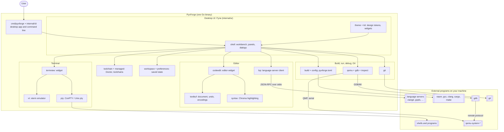

**A. Application core.** `cmd/pyxforge` shows a start-up screen (`internal/ui/splash`) while
tools are located, then opens the workbench, or runs a CLI command from `internal/cli`. Commands
live in one registry (`internal/command`), shared by the palette, menus and key bindings.
`internal/proc` makes child processes end with PyxForge: a Windows job object, `Pdeathsig` on
Linux.

**B. Desktop UI.** `internal/ui/shell` assembles the window: rail, explorer, editor tabs, bottom
panel, inspector, status bar, palette and notifications. Colours come from design tokens in
`internal/ui/theme`, so widgets restyle when the theme changes.

**C. Editor.** `internal/textbuf` holds each document (lines of runes, grouped undo, atomic save
that keeps line endings, BOM and encoding). `internal/syntax` reduces Chroma tokens to a small
set of kinds. `internal/ui/codeedit` draws and edits them. `internal/lsp` speaks LSP 3.17 to one
server per language and project root, negotiating UTF-32 positions and falling back to UTF-16.
There is no Lua and no plugin system; Tree-sitter was evaluated and deferred.

**D. Terminal.** `internal/pty` runs a program on ConPTY (Windows) or a Unix pty, reports its
exit status, and drains its last output before closing. `internal/vt` emulates an xterm screen
with history. `internal/term` joins the two, and `internal/ui/termview` draws the screen and
encodes keys, pastes and mouse input. New sessions start the user's shell (`%COMSPEC%` or
`$SHELL`) in the workspace folder.

**E. Toolchain.** `internal/toolchain` looks for each tool in a fixed order: a path chosen in
Doctor, a copy bundled with PyxForge, a toolchain PyxForge installed, `PATH`, then the tool's
usual install folders. `internal/managed` installs pinned, SHA-256-checked toolchains on Windows
when asked. Nothing is downloaded on start-up.

| Dependency | How it is provided |
|---|---|
| Go 1.27.4+, a C compiler for cgo | Build-time only |
| Git | Bundled (MinGit) in the Windows installer, otherwise from the system |
| GCC, GDB, NASM, binutils | System, or managed toolchains on Windows |
| QEMU | System; on Windows, its official installer, run with approval |
| Language servers | Installed by you (optional) |

**F. Configuration and persistence.** Projects are described by `pyxforge.toml`
(`internal/config`): build profiles, `[qemu]` and `[gdb]`. Per-workspace layout, open files and
breakpoints are kept in the user config folder (`internal/workspace`). Theme and preferences use
Fyne's preferences store. Tool paths chosen in Doctor go to `tools.json`. Nothing is written into
a project except what its build tools write.

**G. Packaging.** `tools/winpkg` builds the Windows installer (Inno Setup) and portable zip. Each
program is built twice and must be byte-identical, and an SPDX SBOM is written.
`tools/linuxpkg` builds the `.deb`, a portable tarball and an AppImage.
`.github/workflows/release-windows.yml` attests build provenance. Details are in
[`docs/INSTALL.md`](docs/INSTALL.md).

## Engineering principles and architectural foundations

These are the ideas the design rests on, with the primary sources behind them. They are design
rationale, not separate features.

- **Go.** A compiled language with a small runtime, a standard library that covers processes and
  files on every platform, and goroutines. PyxForge reads many child processes' output
  (servers, shells, QEMU, GDB) without blocking the UI. The cost is cgo: Fyne's OpenGL driver
  needs a C compiler, so each platform builds on that platform.
  [Go documentation](https://go.dev/doc/), [cgo](https://pkg.go.dev/cmd/cgo)
- **Fyne.** A Go toolkit that draws its own widgets with OpenGL instead of wrapping native
  controls. Rendering is identical across platforms, and PyxForge can run its own design tokens.
  The known gap is that Fyne exposes no accessibility API, so screen readers cannot read the UI;
  PyxForge keeps every action reachable by keyboard and by the CLI.
  [Fyne documentation](https://docs.fyne.io/), [repository](https://github.com/fyne-io/fyne)
- **Language Server Protocol.** Editor intelligence comes from per-language servers over
  JSON-RPC, so PyxForge implements one client rather than per-language analysis.
  [LSP 3.17 specification](https://microsoft.github.io/language-server-protocol/specifications/lsp/3.17/specification/)
- **Pseudo-terminals.** Windows' ConPTY (Windows 10 1809+) and the Unix pty give programs a real
  terminal, so shells, compilers and full-screen tools behave as they do in a terminal app. The
  emulator follows xterm's control sequences.
  [Windows pseudoconsole](https://learn.microsoft.com/en-us/windows/console/creating-a-pseudoconsole-session),
  [xterm control sequences](https://invisible-island.net/xterm/ctlseqs/ctlseqs.html)
- **Offline-first and local data.** Projects, settings and history stay on the machine, and the
  app is fully usable without a network, in the spirit of local-first software.
  [Ink & Switch, *Local-first software*](https://www.inkandswitch.com/local-first/)
- **Reproducible, verifiable distribution.** Byte-identical rebuilds, SHA-256 sums, SPDX SBOMs
  and provenance attestations let users check what they install.
  [Reproducible Builds](https://reproducible-builds.org/), [SPDX](https://spdx.dev/)
- **History: Neovim, Lua and Tree-sitter.** Early 3.0 builds drove Neovim over its UI protocol,
  configured in Lua. That was replaced by PyxForge's own editor (D16); Tree-sitter was evaluated
  and is deferred.
  [Neovim UI protocol](https://neovim.io/doc/user/ui.html), [Lua](https://www.lua.org/manual/),
  [Tree-sitter](https://tree-sitter.github.io/tree-sitter/)

## Technology stack

| Category | Technology | Notes |
|---|---|---|
| Language |  | `go 1.27.4` in `go.mod` |
| Desktop GUI | Fyne v2.8.2 | OpenGL rendering through cgo |
| Syntax highlighting | Chroma v2 (MIT) | Lexers compiled into the binary |
| Terminal | ConPTY (`golang.org/x/sys/windows`), `creack/pty` (Unix), own xterm emulator | `go-runewidth` for wide characters |
| Configuration | TOML (`BurntSushi/toml`) | `pyxforge.toml` |
| File watching | `fsnotify` | Explorer follows the disk |
| Disassembly | `golang.org/x/arch` | x86 decoding in the inspector |
| Version control | Git (external; MinGit bundled on Windows) | Run with argument lists |
| CI/CD |  | `ci.yml` (Windows, Ubuntu, macOS compile, govulncheck), `fuzz.yml`, `dependencies.yml`, `release-windows.yml` |
| Packaging | Inno Setup, `.deb`, AppImage, SPDX SBOM | `tools/winpkg`, `tools/linuxpkg` |
| Fonts and icons | Geist, JetBrains Mono, Syne (OFL), Lucide icons | Bundled |
| Platforms | Windows 11 x64, Ubuntu 24.04 x64 | macOS compile-checked only |

- **Core dependencies** (compiled in): Fyne, Chroma, `x/sys`, `x/arch`, `x/crypto`, `x/image`,
  TOML, `fsnotify`, `go-runewidth`, `creack/pty`, `oksvg`/`rasterx`.
- **Optional integrations** (found at run time): language servers, Git, QEMU, GDB, compilers.
- **Development tools:** staticcheck, govulncheck, `tools/forbidcheck`, `tools/snapshot` (UI renders).

## Themes and appearance

Themes are token sets in `internal/ui/theme`: a palette (surfaces, text, borders, syntax) plus an
accent. The design is flat, with hairline borders and no gradients, glow or glass (decision
D18). `TestContrast` checks every combination. The contrast figures below are computed from the
token values against WCAG 2.1, where AA requires 4.5:1.

| Theme | Status | Character | Text / accent contrast on the base |
|---|---|---|---|
| **Smoked Kraft** | Available, default dark | Warm charcoal (`#1c1916`) with chalk text (`#e8e6e1`): a workshop at night. Syntax in muted earth tones | text 14.0:1, Crimson 4.8:1, Amber 10.3:1 |
| **Ink & Paper** | Available, default light | Off-white paper (`#faf9f6`) and near-black ink (`#1a1c1c`): flat, opaque, editorial | text 16.3:1, Crimson 6.3:1, Amber 5.1:1 |
| **Verdigris Forge** | Available | Deep patinated green (`#111e1a`) with cream text (`#f4ede2`): industrial, tinted | text 14.7:1, Crimson 4.7:1, Amber 10.1:1 |
| **Monochrome + Crimson** | Available | True neutral greys over a black well (`#0c0c0c`). Weight, not hue, separates syntax; the crimson accent (`#e0566a`) carries focus and selection | text 16.7:1, accent 5.3:1 |
| **Monochrome + Amber** | Available | The same neutral base with the warm amber accent (`#f6bb84`) | text 16.7:1, accent 11.5:1 |
| **Ink & Glass** | Retired (D18) | A translucent "glass" variant of Ink & Paper. Retired with the flat redesign: translucency over text cost legibility. A saved choice falls back to the default | — |

Every palette takes either accent: **Crimson**, PyxForge's signature, or **Amber**. **System**
follows the operating system, using Ink & Paper when light and Smoked Kraft when dark.

| Smoked Kraft + Crimson | Ink & Paper + Crimson |
|---|---|
|  | 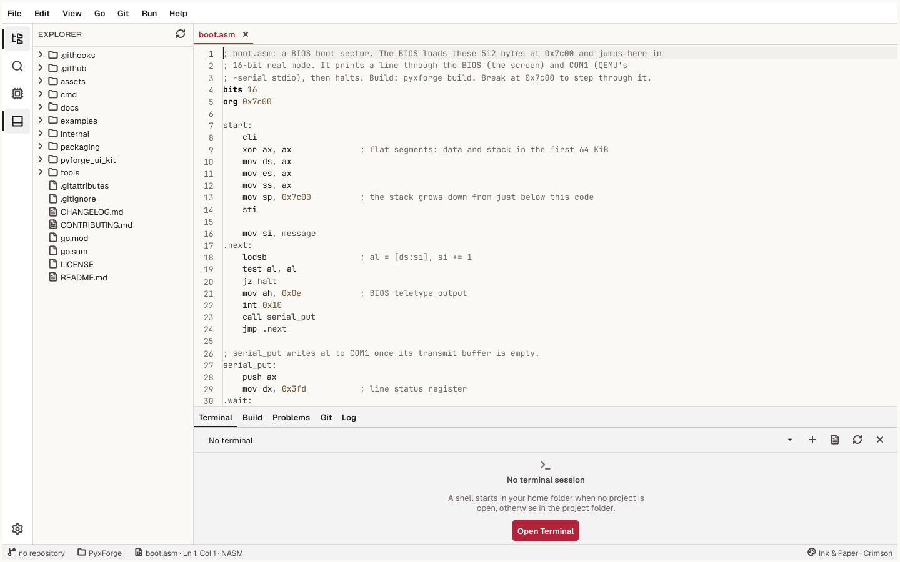 |
| **Verdigris Forge + Crimson** | **Smoked Kraft + Amber** |
| 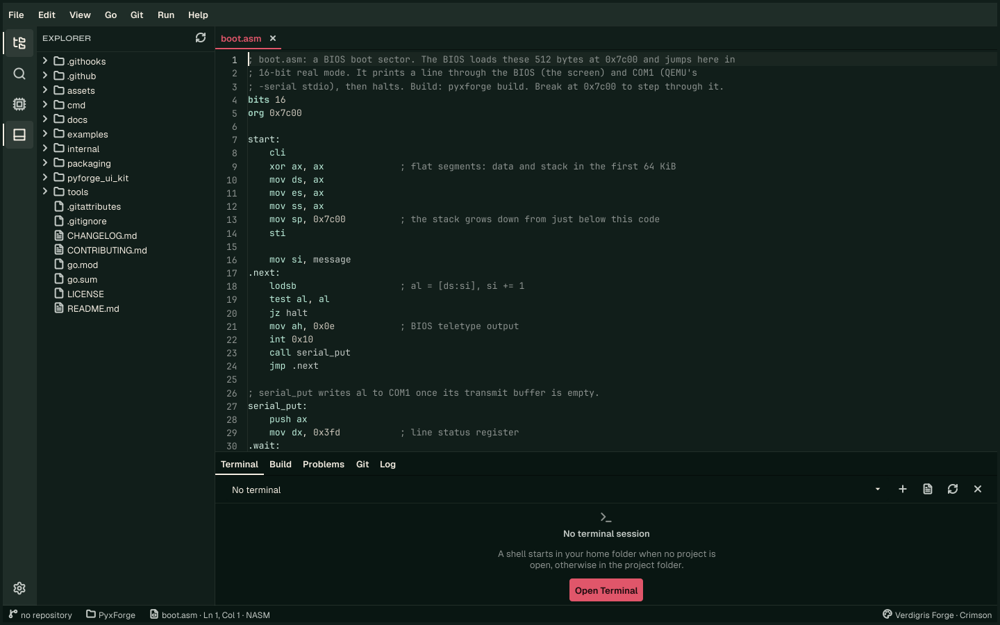 | 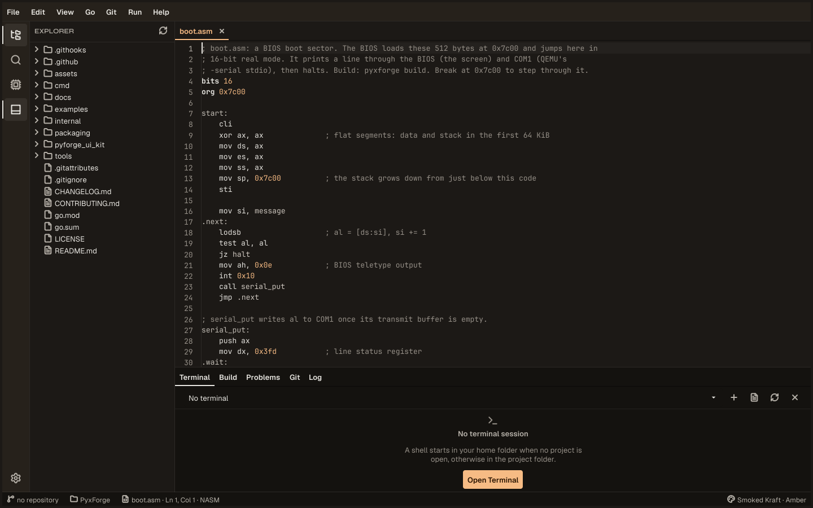 |
| **Monochrome + Crimson** | **Monochrome + Amber** |
| 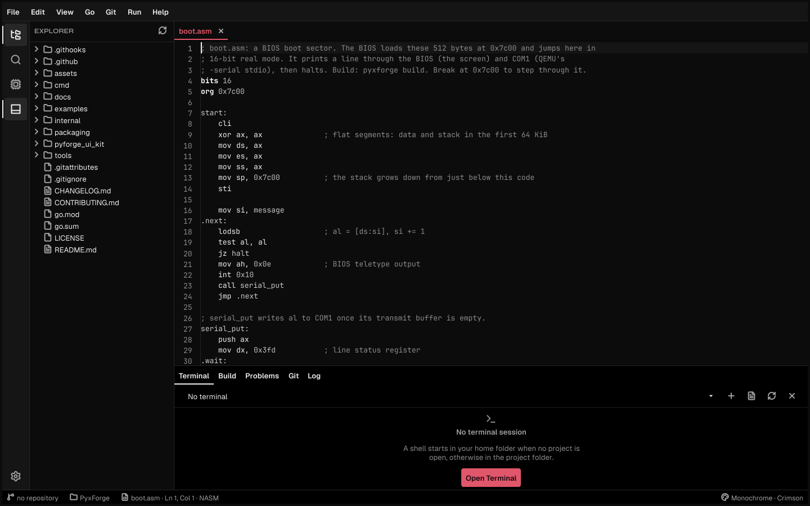 | 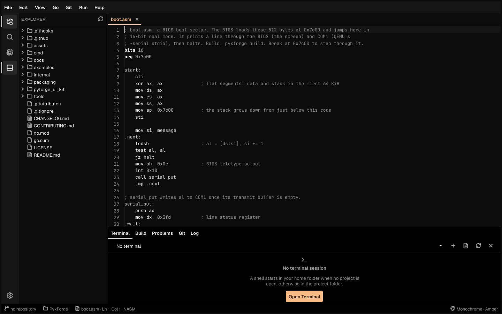 |

## Part of the PyxisOS ecosystem

PyxForge is one of three related, independently developed projects by the same maintainer:

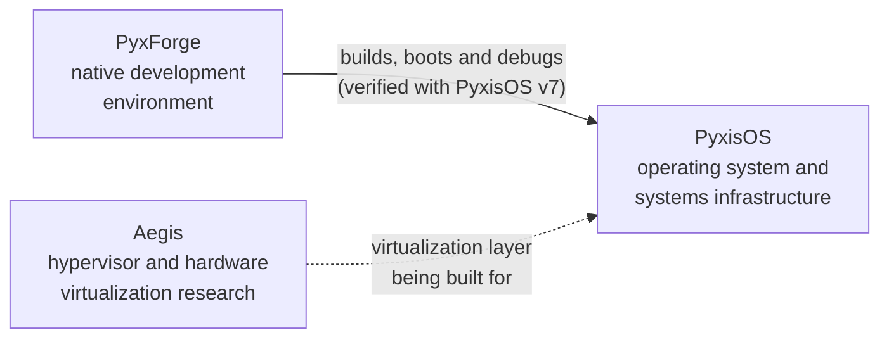

- [**PyxisOS**](https://github.com/obstinix/PyxisOS) is an experimental AI-oriented operating
  system for x86-64 hardware, covering the OS and systems-infrastructure layer.
- **PyxForge** covers the developer-tooling layer: a general environment for C, C++, Rust, Go,
  assembly and other projects.
- [**Aegis**](https://github.com/obstinix/Aegis) is a staged x86-64 hypervisor research project,
  described by its README as the virtualization layer being built for PyxisOS.

PyxForge is **not** the operating system. It does not need PyxisOS to run, and it is not made
only for it. There is no PyxisOS-specific integration in the code. What has been verified is
using PyxForge as the development environment for PyxisOS v7: its Makefile run as a build
profile, the kernel booted in QEMU, and GDB stopping at `kernel_main`, on Windows and Ubuntu. See
[`docs/cross-project/pyxisos-integration.md`](docs/cross-project/pyxisos-integration.md).

## Screenshots

Images are the real application, rendered offscreen by Fyne's software renderer at 1440×900
(`tools/snapshot` and the same code path), not mock-ups.

| Debugging a boot sector in QEMU with GDB | A shell session in the Terminal panel |
|---|---|
| 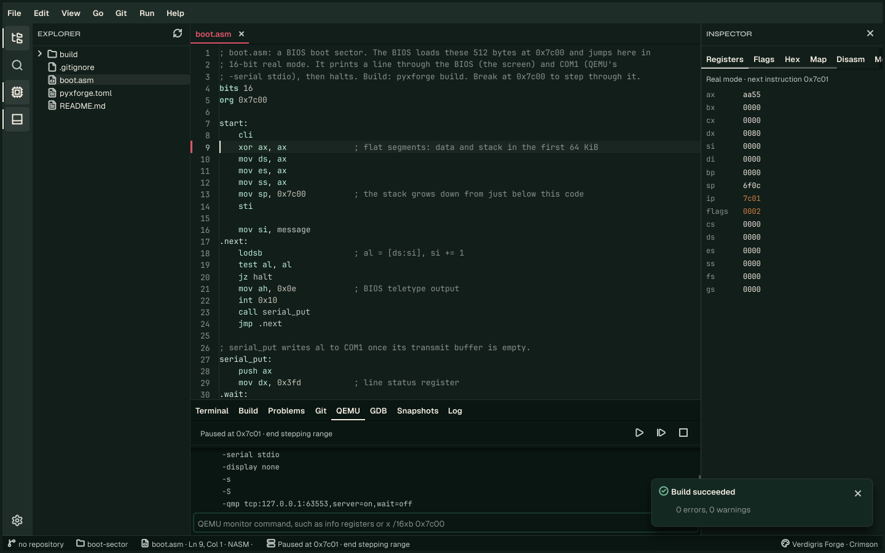 | 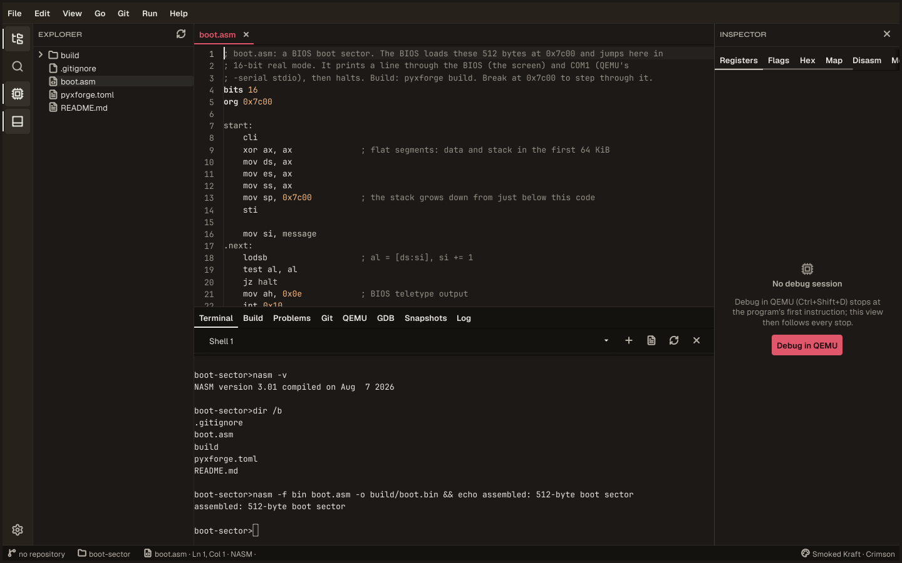 |
| **A build with streamed output** | **Settings: theme and accent** |
| 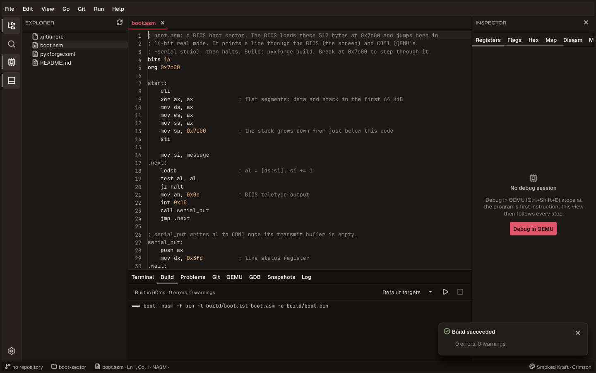 | 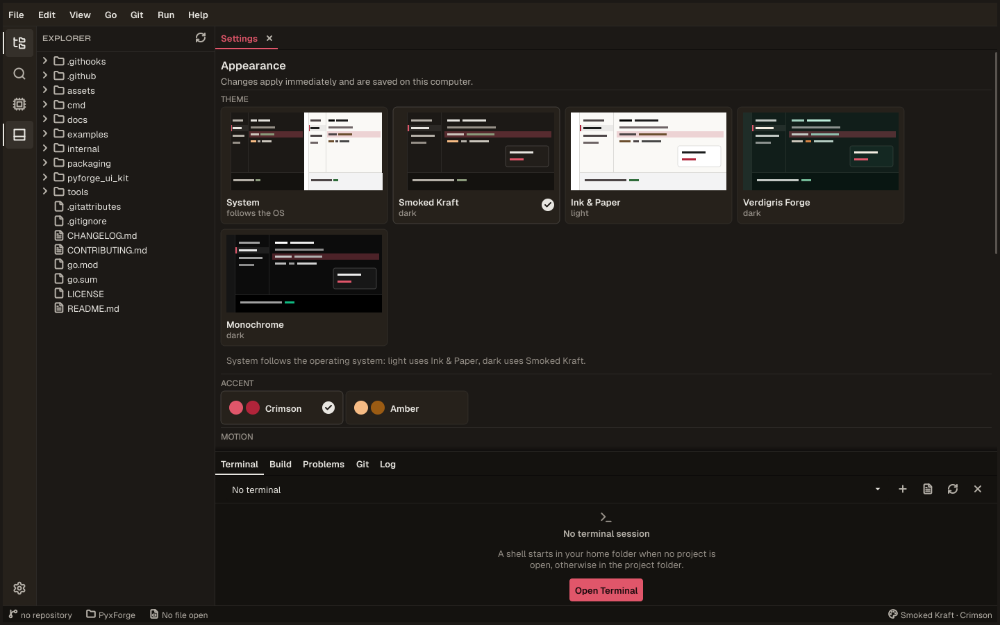 |

## Installation

### Prebuilt builds

Pre-releases are on the [Releases page](https://github.com/obstinix/PyxForge/releases): a Windows
installer, a portable zip and standalone executables. They are not code-signed, so SmartScreen may
warn. As noted under [Development status](#development-status), the published builds predate
the native editor and terminal. Verify a download against the release's `SHA256SUMS.txt`:

```powershell
Get-FileHash .\PyxForge-Setup-<version>.exe -Algorithm SHA256
```

### Build from source

You need **Go 1.27.4 or newer** and a **C compiler** for cgo (Fyne draws with OpenGL). The desktop
app also needs an OpenGL 2.1 driver.

**Windows (PowerShell),** with a MinGW-w64 GCC or LLVM-MinGW on `PATH`:

```powershell
git clone https://github.com/obstinix/PyxForge.git
cd PyxForge
go build -o pyxforge.exe ./cmd/pyxforge
.\pyxforge.exe doctor
```

**Ubuntu / Debian:**

```sh
sudo apt-get install gcc libgl1-mesa-dev libx11-dev xorg-dev libwayland-dev libxkbcommon-dev
git clone https://github.com/obstinix/PyxForge.git
cd PyxForge
go build -o pyxforge ./cmd/pyxforge
./pyxforge doctor
```

Optional tools enable their own features: NASM or GCC and Clang to build, QEMU to run, GDB to
debug, Git for the Git tab, and language servers for completion. `pyxforge doctor --commands`
prints install commands for whatever is missing, for you to review and run.

**Troubleshooting:** the window does not open when there is no OpenGL 2.1 driver; install the GPU
vendor's driver, or Mesa on Linux. A tool installed off `PATH` can be chosen in **Tools:
Doctor…**. More is in [`docs/INSTALL.md`](docs/INSTALL.md).

## Quick start

The repository ships a 512-byte boot sector in [`examples/boot-sector`](examples/boot-sector).
It needs NASM and QEMU:

```sh
cd examples/boot-sector
pyxforge build                 # nasm -f bin ... -> build/boot.bin
pyxforge inspect build/boot.bin
pyxforge run                   # boots it; the serial console prints "PyxForge boot sector OK"
pyxforge .                     # or open it in the desktop app
```

In the app:

| Key | Action |
|---|---|
| `Ctrl+Shift+P` | Command palette (every action) |
| `Ctrl+P` | Go to File |
| `Ctrl+Shift+B` | Build |
| `Ctrl+Shift+D` | Debug in QEMU |
| `Ctrl+Shift+F9` | Run Current File |
| `F9` / `F12` / `F2` | Breakpoint / go to definition / rename |
| ``Ctrl+Shift+` `` | New terminal |

All key bindings are listed in [`docs/architecture/KEYMAP.md`](docs/architecture/KEYMAP.md).

## Project structure

```text
cmd/pyxforge/          entry point: desktop app and CLI
internal/
  ui/                  Fyne UI: shell (workbench), codeedit (editor), termview (terminal),
                       explorer, commandpalette, notifications, kit and theme (design system),
                       splash, brand, icons
  textbuf/ syntax/ lsp/            editor model, highlighting, language-server client
  pty/ vt/ term/                   pseudo-terminal, terminal emulator, sessions
  build/ config/ runfile/          build profiles, pyxforge.toml, Run Current File
  qemu/ gdb/ inspect/ listing/ snapshot/   machines, debugger, binary inspection
  git/ askpass/                    Git operations and credential prompts
  toolchain/ managed/ update/      tool detection, managed toolchains, update check
  workspace/ proc/ trash/ ...      persistence, process supervision, recycle bin
tools/                 snapshot renders, winpkg, linuxpkg, release, forbidcheck, ...
packaging/             Windows installer script, Linux desktop entry
examples/boot-sector/  NASM boot sector with a pyxforge.toml
docs/                  decisions, state, features, install guide, design system, archive
assets/                README logo and screenshots
```

The 2.x implementation (Tauri, VS Code extension, Rust core) is no longer in the tree. It is in
git history up to commit `fd193a2` and documented in [`docs/archive/2.x`](docs/archive/2.x/README.md).

## Roadmap

**Current development**
- A side-by-side Git diff view in the native editor.
- Testing the configured language servers beyond clangd against the editor.

**Short term**
- Installers tried on clean machines, and Linux packages tested beyond Ubuntu.
- QEMU serial and GDB as Terminal sessions, and machine facts from QMP in the status bar.
- An offline CI job that runs the suite with the network cut.

**Long-term research (exploratory)**
- macOS support, once the app and integration tests have run there.
- Code signing, which needs a certificate.
- Screen-reader accessibility, which depends on Fyne gaining an accessibility API.

**Not planned:** AI agents or coding assistants.

The detailed, evidence-based roadmap is [`docs/ROADMAP.md`](docs/ROADMAP.md), and decisions are
recorded in [`docs/ARCHITECTURE_DECISIONS.md`](docs/ARCHITECTURE_DECISIONS.md).

## Contributing

1. Fork the repository and create a branch for your change.
2. Enable the shared hook: `git config core.hooksPath .githooks`.
3. Make the change. Pull requests that touch process lifecycle (builds, QEMU, GDB, terminals)
   should include a test against the real program.
4. Run the checks CI runs: `gofmt -l .`, `go vet ./...`, `staticcheck ./...`,
   `go test -race ./...` and `go run ./tools/forbidcheck`.
5. Open a pull request against `main`.

The rules (no web technology, offline first, no fake data, no committed secrets) are in
[`CONTRIBUTING.md`](CONTRIBUTING.md). For bugs and feature requests, use
[issues](https://github.com/obstinix/PyxForge/issues). For a security problem, please do not open
a public issue; contact the maintainer through their [GitHub profile](https://github.com/obstinix)
first. There is no `SECURITY.md` yet.

## Contributors

- [**@obstinix**](https://github.com/obstinix): creator and maintainer.
- [**@t7-rehan**](https://github.com/t7-rehan): contributor.
- One further account on the contributors page, `antigravity-google-bot`, is an automated account.

See the [contributors graph](https://github.com/obstinix/PyxForge/graphs/contributors),
[issues](https://github.com/obstinix/PyxForge/issues) and
[pull requests](https://github.com/obstinix/PyxForge/pulls). Discussions are not enabled.

## License and code of conduct

PyxForge is licensed under the **[Apache License 2.0](LICENSE)**. You may use, modify and
redistribute it, including commercially, provided that you:

- include the license;
- keep the existing notices;
- state significant changes to files you modify.

The license also grants a patent license from contributors, which ends for anyone who brings
patent litigation over the work. It gives no trademark rights and comes without warranty. The
`LICENSE` file is the standard text without a separate copyright line. Third-party components
keep their own licenses, listed in `THIRD-PARTY-NOTICES.txt` in each Windows release.

There is no `CODE_OF_CONDUCT.md` yet. Until one is adopted, contributors are expected to be
respectful and constructive. A standard such as the Contributor Covenant is a likely candidate.

## Acknowledgements

- [Fyne](https://github.com/fyne-io/fyne), the GUI toolkit PyxForge is built on.
- [Chroma](https://github.com/alecthomas/chroma), whose lexers descend from [Pygments](https://pygments.org/).
- [creack/pty](https://github.com/creack/pty), and Microsoft's ConPTY.
- [Geist](https://github.com/vercel/geist-font), [JetBrains Mono](https://github.com/JetBrains/JetBrainsMono)
  and Syne fonts (SIL OFL), and [Lucide](https://github.com/lucide-icons/lucide) icons.
- QEMU, GDB, NASM, Git and the language-server authors whose tools PyxForge drives.

## References

- Go: <https://go.dev/doc/> · cgo: <https://pkg.go.dev/cmd/cgo>
- Fyne: <https://docs.fyne.io/> · <https://github.com/fyne-io/fyne>
- Language Server Protocol 3.17: <https://microsoft.github.io/language-server-protocol/specifications/lsp/3.17/specification/>
- Windows pseudoconsole (ConPTY): <https://learn.microsoft.com/en-us/windows/console/creating-a-pseudoconsole-session>
- xterm control sequences: <https://invisible-island.net/xterm/ctlseqs/ctlseqs.html>
- QEMU Machine Protocol: <https://www.qemu.org/docs/master/interop/qmp-spec.html>
- GDB/MI: <https://sourceware.org/gdb/current/onlinedocs/gdb.html/GDB_002fMI.html>
- Local-first software (Ink & Switch): <https://www.inkandswitch.com/local-first/>
- Reproducible Builds: <https://reproducible-builds.org/> · SPDX: <https://spdx.dev/>
- WCAG 2.1 contrast: <https://www.w3.org/TR/WCAG21/#contrast-minimum>
- Historical: Neovim UI protocol <https://neovim.io/doc/user/ui.html> · Lua <https://www.lua.org/manual/> · Tree-sitter <https://tree-sitter.github.io/tree-sitter/>

<p align="center"><sub>Built by <a href="https://github.com/obstinix">@obstinix</a> · no telemetry · works offline</sub></p>
